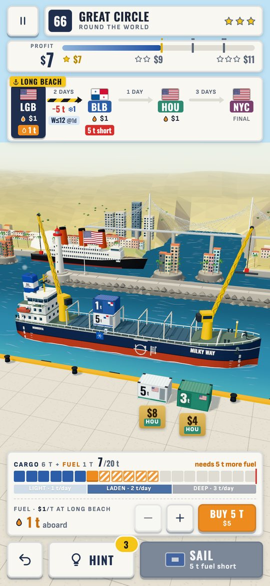
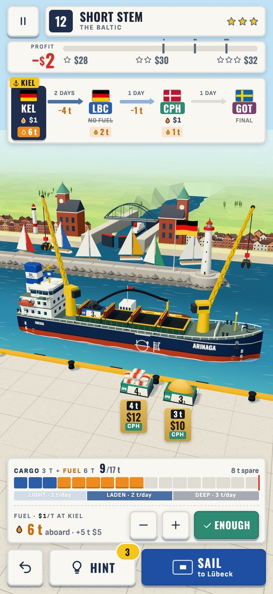
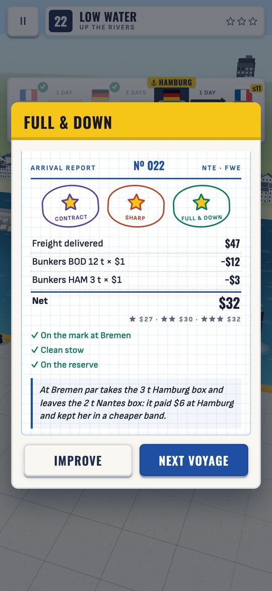
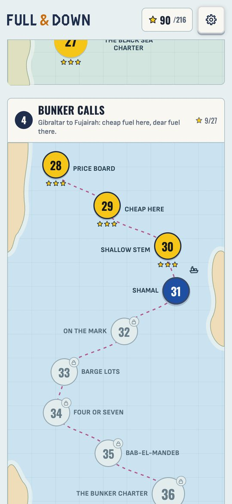

# ⚓ Full & Down

*Load her to the marks. Not a tonne more.*

A cozy 3D puzzle about bunkers, cargo and the load line. Sail a voyage port by port: at each call,
choose what to load, on which stack, and how much fuel to buy. Fuel weighs too, and a deeper ship
burns more. Take too little and she never arrives; take too much and you've left freight on the quay.

### ▶ [Play now](https://evgeny.io/games/full-and-down/)

Free in any browser, on phone or desktop. No install, no ads.

<p align="center">
  
  
  
  
</p>

- 🧭 **72 voyages** round the world in eight sea areas: the North Sea, the Baltic, the Black Sea,
  the bunker calls from Gibraltar to Fujairah, the China Seas, the Banana Coast, the North Pacific
  and a voyage round the world, with up to five calls each
- 🌍 Real ports with their own flags and skylines, and a word from the pilot as she comes alongside:
  Odessa's Potemkin Stairs, the Bridge of the Americas, Table Mountain with her tablecloth on…
- 🚢 Container feeders that stack, and small bulk carriers with open holds and a grab, in OAL's
  royal blue funnel colours, the bulkers named after Unimor's Supramaxes
- ⛽ Fuel weighs, heavier ships burn more, and some ports sell no bunkers
- 📦 Stacks that must come off in order, harbour bars, price spreads, barge lots, heavy-below-light,
  reefers, contract cargo, winter load lines and low bridges, each one introduced on its own
- 🎯 Every level's difficulty is **measured**. An exact solver knows the best voyage (★★★), and
  simulated players set the other stars.
- 🚩 Signal-flag UI: Blue Peter goes up when she's ready to sail, and a perfect voyage dresses her
  overall

*Full and down* is the chartering phrase for a ship whose holds are full and which sits down to her
load-line marks.

## Development

```bash
npm install
npm run dev      # http://localhost:5200
npm test
```

Pushing to `main` deploys the game. The rules, the solver, the level generator and the debug flags
are described in [docs/development.md](docs/development.md); the design and how it was reached are in
[docs/design.md](docs/design.md) and [docs/design-process](docs/design-process).

<sub>Fonts: Oswald and Sofia Sans (OFL 1.1). 3D: [three.js](https://threejs.org) (MIT). All models are
built in code and all sounds are synthesised in the browser.</sub>
